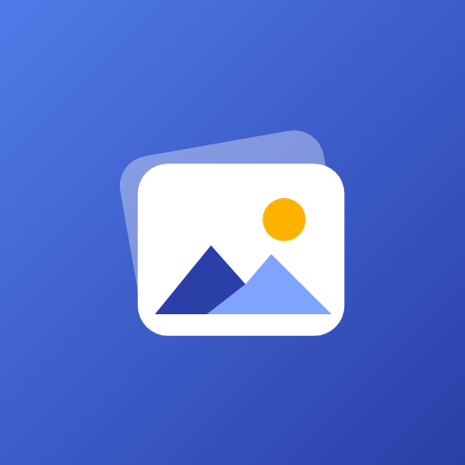
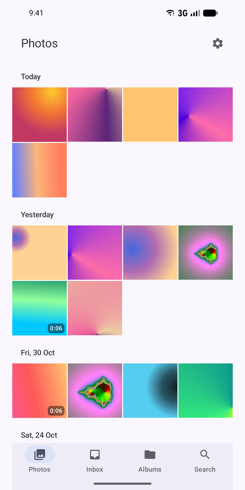
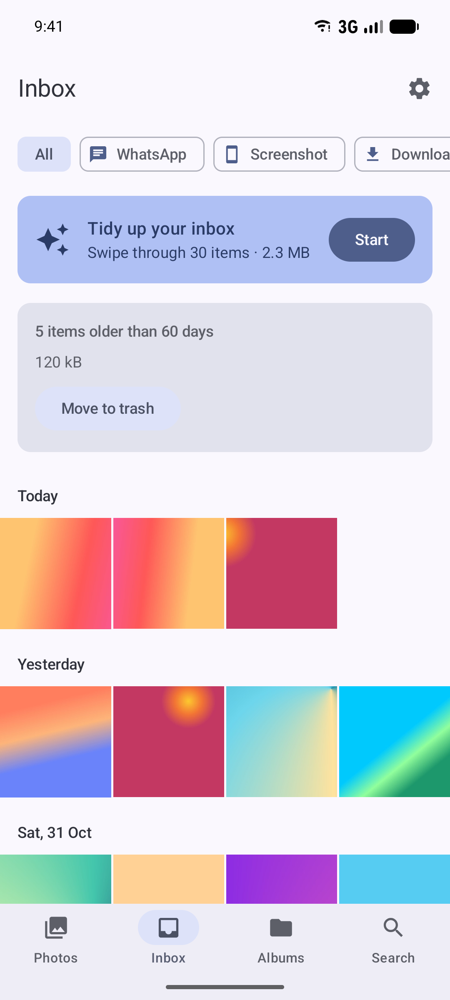
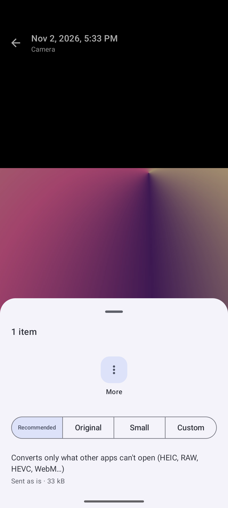
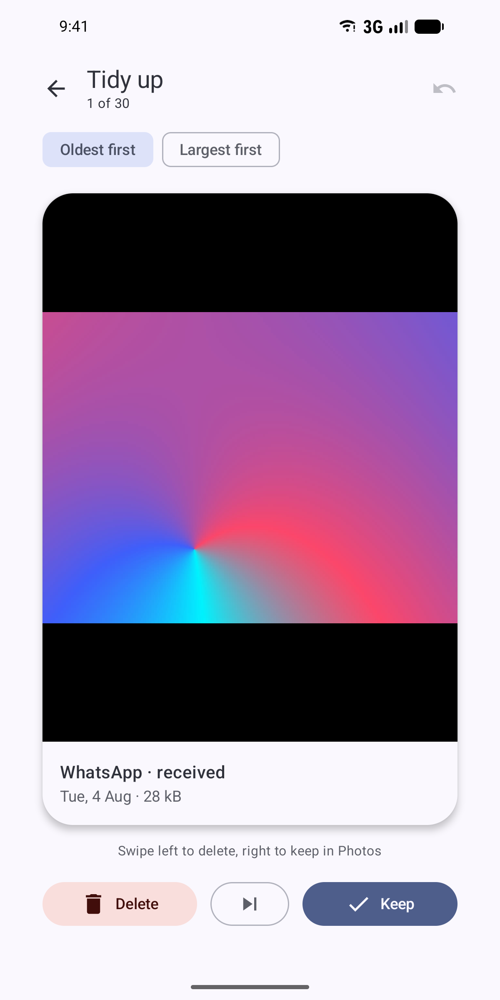
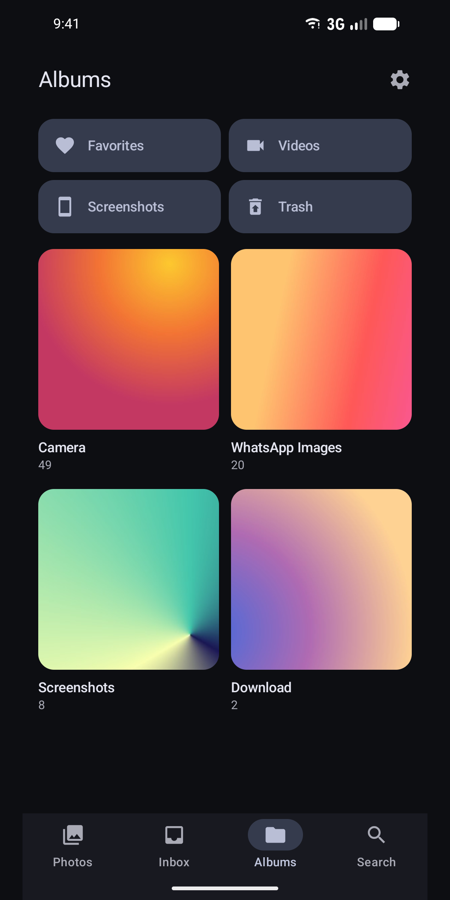

<p align="center">
  
</p>

<h1 align="center">Plain Gallery</h1>

<p align="center">
  A photo gallery for Android that just works.<br>
  No ads, no backup nagging, no internet permission.
</p>

<p align="center">
  <a href="https://github.com/Matthew-Eucaristo/plain-gallery/actions/workflows/ci.yml"></a>
  <a href="LICENSE"></a>
  
  
</p>

<p align="center">
  
  
  
  
  
</p>

## Why

Phone galleries show ads; cloud galleries keep asking to back up until your free storage is full. Plain Gallery is just a gallery: fast, simple enough for parents, and physically unable to upload anything because it has no network access.

## Features

- **Photos and Inbox, kept apart.** Camera photos in *Photos*; WhatsApp images, screenshots, downloads and Telegram media in *Inbox*, with one-tap clean-up of old items and a swipe-to-tidy mode (left to delete, right to keep).
- **Fast.** Local index with incremental sync, system thumbnail cache, Baseline Profile, optimistic deletes with Undo. Pinch to change density (the grid follows your fingers), drag the scrubber through years.
- **On this day**: photos from today's date in earlier years, as cards on top of *Photos*.
- **People**: faces are recognized and grouped by person on the phone itself (YuNet + SFace through LiteRT, ~10 MB, no internet). Name someone and search for them; give two groups the same name to join them.
- **Search text inside photos**: screenshots, receipts, tickets are read on the phone (PP-OCRv6 tiny, ~2 MB) so `boarding pass` or `rp 125.000` finds them. Copy the text from Info.
- **Screenshots know their app** (Samsung, Xiaomi, Huawei/Honor name it in the file): "Screenshot · Instagram", searchable.
- **Your own albums**: select photos (long-press, drag), *Add to album*. Files stay where they are.
- **Create**: collage (2–9 photos; grid, rows, columns; 1:1, 4:5, 9:16), Instagram grid (3, 6 or 9 posts, numbered in posting order), trim video (with or without sound). Always saved as new files.
- **Swipe between tabs**, or tap the bar.
- **Search that understands you**, in English and Indonesian: `wa july 2024`, `screenshot yesterday`, `video favorites`, `eid 2023`, a person's name, or part of a file name.
- **Share in one tap** to WhatsApp or the app you used last. *Recommended* (default) converts only what other apps can't open: HEIC/AVIF/RAW → JPEG, HEVC/VP9/AV1/WebM/MKV → H.264 MP4. Also *Original*, *Small* (1600 px photos, 720p video) and *Custom* (JPG/PNG/WebP, photo size, 1080p/720p/480p).
- **Opens everything**: JPEG, PNG, WebP, GIF, HEIC/HEIF, AVIF, DNG, BMP; MP4, MOV, 3GP, MKV, WebM, AVI with H.264, HEVC, VP8/9, AV1, MPEG-4. Ultra HDR on Android 14+.
- **Simple editor**: crop and rotate, filters and light/colour sliders, pen and highlighter. Saves a copy next to the original, keeping date and location.
- **Default viewer** for photos and videos from any app and from the camera's preview button.
- **Safe**: deletes go to the system Trash for 30 days. Follows system light/dark and wallpaper colors.

## Install

- **GitHub Releases**: download the APK from [Releases](https://github.com/Matthew-Eucaristo/plain-gallery/releases).
- **Google Play**: in review (closed testing first).

Requires Android 11 or later.

## Privacy

No internet permission, no accounts, no analytics, no ads. CI fails the build if the APK ever requests network access. See [PRIVACY.md](PRIVACY.md).

## Build

```bash
./gradlew :app:assembleRelease
adb install app/build/outputs/apk/release/app-release.apk
```

Kotlin, Jetpack Compose, Material 3 Expressive, Navigation 3, Room 3, Coil 3, Telephoto, Media3 (ExoPlayer, Transformer), LiteRT (on-device models: [faces](core/faces/MODELS.md), [text](core/text/MODELS.md)).

- [docs/SPEC.md](docs/SPEC.md) — product spec and roadmap (Indonesian)
- [AGENTS.md](AGENTS.md) — architecture, invariants and checks
- [docs/RELEASING.md](docs/RELEASING.md) — signing, Google Play

## Contributing

Issues and pull requests are welcome. Read [AGENTS.md](AGENTS.md) first: the app must stay offline and fast, and every string needs English and Indonesian.

## License

[Apache License 2.0](LICENSE)
